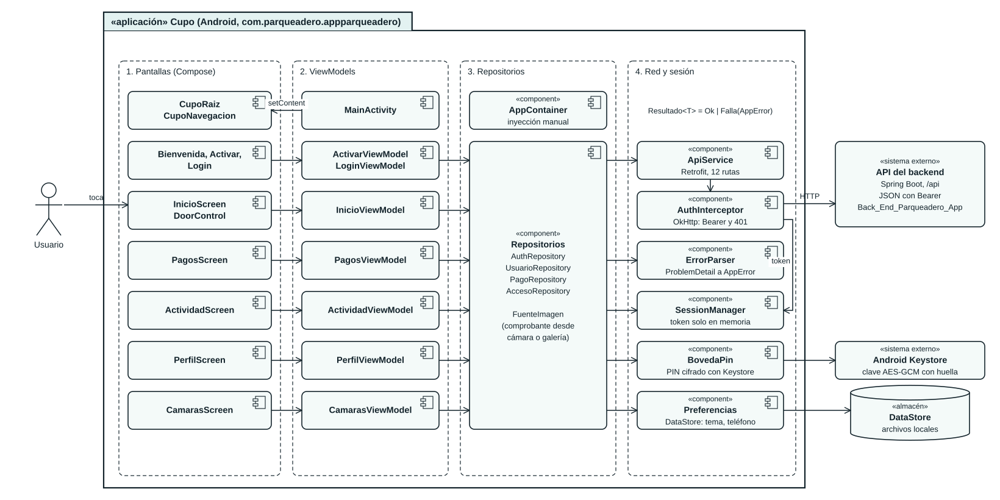
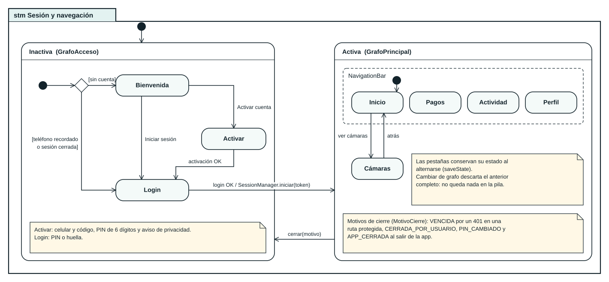
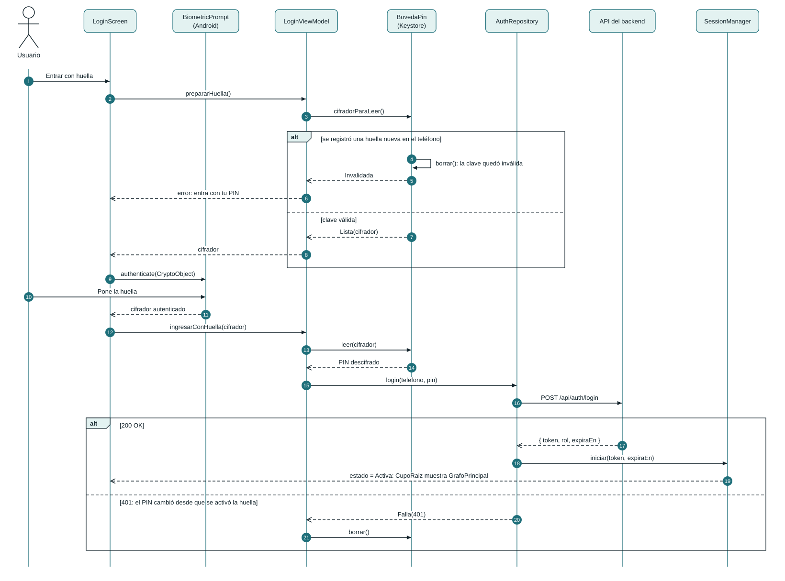
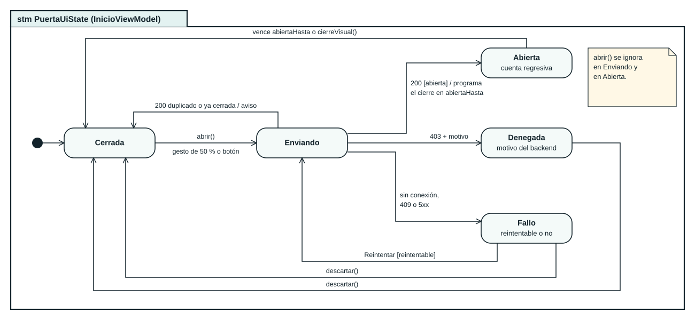

# Cupo, app móvil del parqueadero

App Android para los usuarios de un parqueadero de 6 carros y 1 moto. Con ella activan su cuenta, abren la puerta, pagan la mensualidad con un comprobante y revisan su actividad. Está hecha en Kotlin con Jetpack Compose y Material 3, y se conecta al backend Spring Boot del proyecto ([Back_End_Parqueadero_App](https://github.com/dannygetcode/Back_End_Parqueadero_App)).


Hay videos de demostración de la [versión 1.0](https://youtu.be/dBP5H_squB4) y de la [versión 1.1](https://youtu.be/QO1wIvvKo7I).

## Contenido

1. [Qué hace](#qué-hace)
2. [Arquitectura](#arquitectura)
3. [Sesión y navegación](#sesión-y-navegación)
4. [Ingreso con huella](#ingreso-con-huella)
5. [La puerta](#la-puerta)
6. [Requisitos y ejecución](#requisitos-y-ejecución)
7. [Pruebas](#pruebas)
8. [Novedades de la versión 2.0](#novedades-de-la-versión-20)

## Qué hace

| Sección | Qué permite |
|---|---|
| Acceso | No hay autorregistro. El administrador crea al usuario y le entrega un código. Con ese código se activa la cuenta, se crea un PIN de 6 dígitos y se acepta el aviso de privacidad. Después se entra con PIN o con huella, y al cerrar la app hay que volver a entrar. |
| Inicio | Estado de la mensualidad, placa y cupo. La puerta es una persiana simulada que se abre deslizando hacia arriba y se cierra sola. |
| Pagos | Próximo periodo y monto, subida del comprobante (cámara o galería, JPEG o PNG de hasta 5 MB) e historial por año. |
| Actividad | Resumen con días restantes, pagos del año, visitas, permanencia y hora habitual. También muestra las visitas por semana y los movimientos. |
| Perfil | Datos y vehículo, cambio de PIN, huella, tema claro, oscuro o del sistema, y cierre de sesión. |
| Cámaras | Vista de demostración. No hay video real. |

## Arquitectura

La app sigue MVVM en cuatro capas. Cada pantalla de Compose observa un `StateFlow<UiState>` de su ViewModel y le envía los eventos del usuario. Los ViewModels piden datos a los repositorios. Estos llaman a la API con Retrofit y devuelven un `Resultado<T>`, que es `Ok` o `Falla(AppError)`, así que ningún error de red llega como excepción a la interfaz.

No hay Hilt. `AppContainer` crea una sola instancia de cada repositorio y servicio cuando arranca `CupoApp`, y las fábricas de ViewModel las toman de ahí. `AuthInterceptor` agrega el token a las rutas protegidas. Si una de ellas responde 401, le avisa a `SessionManager` para que cierre la sesión.



## Sesión y navegación

El token vive solo en memoria, dentro de `SessionManager`, y nunca se guarda en disco. El estado de la sesión decide qué grafo de navegación existe. Con la sesión inactiva solo están Bienvenida, Activar y Login; con la sesión activa, las cuatro pestañas y Cámaras. Al cambiar de grafo se descarta el anterior completo, así que el botón atrás nunca devuelve a una pantalla de la otra sesión.



## Ingreso con huella

La huella no guarda el token. Guarda el PIN cifrado con una clave AES-GCM del Android Keystore que solo se puede usar después de autenticarse con huella (`BiometricPrompt` con `CryptoObject`). Al poner la huella, la app descifra el PIN y hace un login normal, así que el token siempre es nuevo.

Si alguien registra una huella nueva en el teléfono, Android invalida la clave y la app borra la bóveda. Si el PIN cambió desde que se activó la huella, el backend responde 401 y la app también la borra. En los dos casos hay que entrar con el PIN y volver a activar la huella en Perfil.



## La puerta

`InicioViewModel` modela la puerta con cinco estados. Mientras la orden está en camino o la puerta está abierta, un nuevo intento se ignora. Si el backend permite el acceso, la app programa el cierre para el instante `abiertaHasta` que él mismo devuelve. Por eso la duración la decide la propiedad `accesos.apertura-segundos` del backend y la app solo muestra la cuenta regresiva. Una salida con deuda se permite y la app muestra el aviso.



## Requisitos y ejecución

Necesitas Android Studio con JDK 17 y SDK 35. El teléfono debe tener Android 7.0 (API 24) o superior. El backend tiene que estar corriendo (`docker compose up` en su repositorio) y escucha en `127.0.0.1:8080`.

1. Abre este repositorio en Android Studio y sincroniza Gradle.
2. En el emulador no hace falta configurar nada, porque la app usa `http://10.0.2.2:8080/`.
3. En un teléfono real conectado por cable, activa la depuración USB y agrega esta línea a `local.properties`.
   ```
   cupo.apiUrl=http://127.0.0.1:8080/
   ```
   Después ejecuta `adb reverse tcp:8080 tcp:8080`, sincroniza Gradle y pulsa Run.
4. Para entrar necesitas un usuario creado desde el panel web del administrador y su código de activación.

## Pruebas

```
./gradlew :app:testDebugUnitTest
```

Son pruebas unitarias en la JVM de los ViewModels y los repositorios, con una API falsa. No necesitan emulador.

## Novedades de la versión 2.0

Es un rediseño completo con la marca Cupo.

- Tema claro y oscuro, tipografía Space Grotesk con Inter y componentes propios. El sistema de diseño está en [`docs/diseno/sistema-cupo.md`](docs/diseno/sistema-cupo.md).
- Activación de cuenta en 3 pasos (celular y código, PIN, aviso de privacidad) y login con PIN o huella.
- Puerta tipo persiana con gesto, vibración y cuenta regresiva. Cámaras con vista simulada.
- Pagos con comprobante validado (JPEG o PNG de hasta 5 MB) e historial por año.
- Actividad con indicadores y un gráfico de visitas por semana hecho con Vico.
- Seguridad. El token solo vive en memoria y al cerrar la app hay que volver a entrar. El PIN de la huella se guarda cifrado con el Keystore. HTTP sin cifrar solo se permite en debug, y las capturas de pantalla se bloquean en release.
- Se corrigen los errores de la versión 1.0. Los pagos ya no envían `userId`, el login maneja errores y estados de carga, la navegación no duplica pantallas y la puerta revierte si la orden falla.


Video de la versión 1.0: https://youtu.be/dBP5H_squB4

Video de la versión 1.1: https://youtu.be/QO1wIvvKo7I
